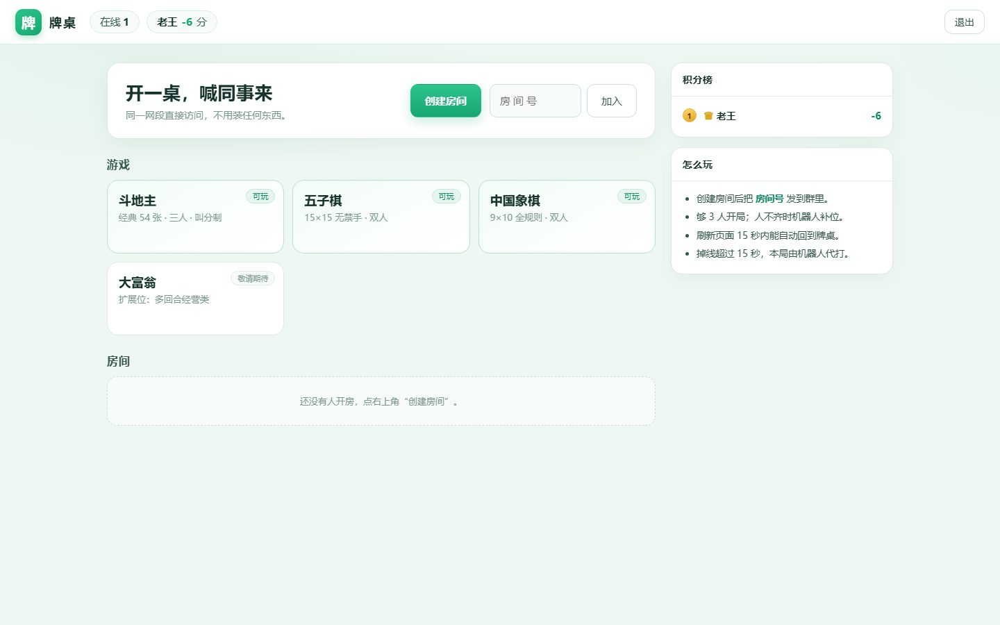
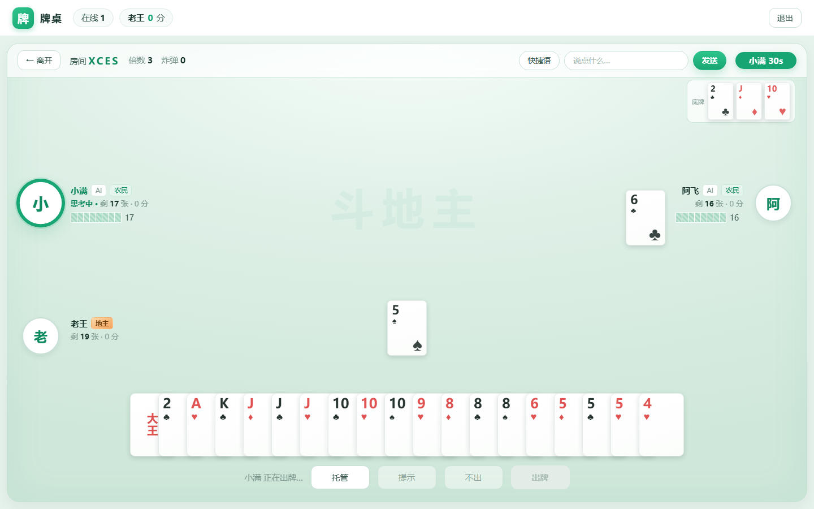
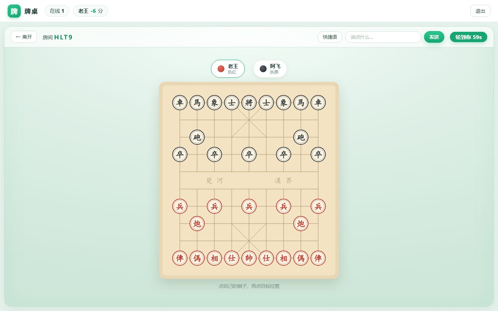
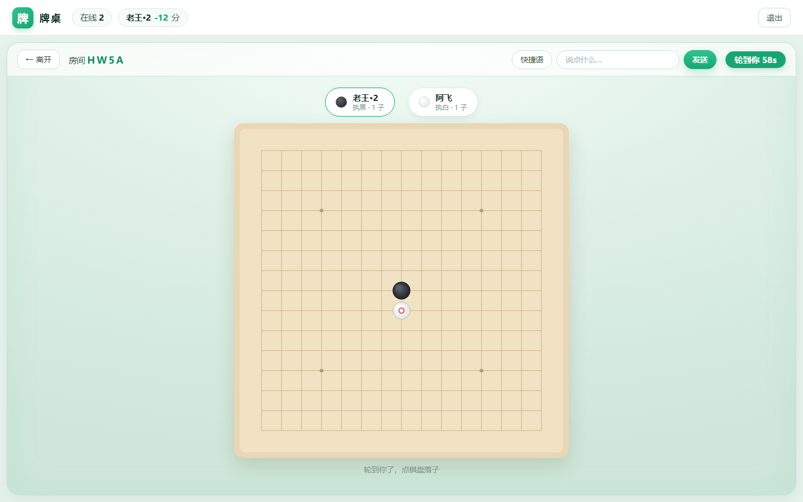

# 牌桌 · 内网联机平台

一个跑在公司内网、用来和同事打斗地主的小平台。特点：

- **零安装**：整个目录拷到任何 Windows 机器上，双击 `启动.bat` 就能跑。不需要装 Node、不需要 `npm install`、不需要数据库。
- **零第三方依赖**：HTTP、WebSocket、会话、存储全部用 Node 内置模块手写，没有 `node_modules` 这种东西。
- **轻**：单进程，十来个人、几桌牌，占用通常在 100MB 内存以内。
- **能扩展**：房间/座位/重连/计时/聊天/积分是通用的，接新游戏只要实现一个类并注册一行。

---

## 界面预览

| 大厅 | 斗地主 |
| --- | --- |
|  |  |

| 中国象棋 | 五子棋 |
| --- | --- |
|  |  |

---

## 一、怎么跑起来

1. 把整个文件夹放在你的笔记本上（`启动.bat`、`node.exe`、`app`、`web` 必须在一起）。
2. 双击 **`启动.bat`**。
3. 窗口里会打印两个地址：

   ```
   本机访问 : http://127.0.0.1:8080
   同事访问 : http://10.112.3.60:8080
   访问口令 : 95599
   ```

4. 把"同事访问"那个地址发到群里，让他们用浏览器打开，输入口令 `95599`。
5. 关掉那个黑色窗口，服务就停了。

第一次如果同事打不开，多半是 Windows 防火墙拦了：右键 **`允许防火墙.ps1`** →「使用 PowerShell 运行」，同意提权即可。

> 笔记本休眠/关机后服务自然消失，这是设计内的。不做开机自启、不做崩溃守护，你打开它才存在。

**关掉服务**（三种方式，任选）：

1. 在 `启动.bat` 的黑色窗口里按 **Ctrl+C**，或直接点窗口右上角的 ×；
2. 双击 **`停止服务.bat`** —— 它会只杀掉本平台的 node 进程，不误伤别的程序；
3. 窗口找不到了：任务管理器 → 详细信息 → 结束 `node.exe`。

---

## 二、玩之前需要知道的规则

- **三人斗地主**，54 张牌，每人 17 张，底牌 3 张。
- **叫分制**：按顺序叫 1/2/3 分，3 分直接定地主；三家都不叫则重新发牌。叫到的分数就是底分。
- **牌型全开**：单张、对子、三张、三带一、三带一对、顺子（≥5 张）、连对（≥3 对）、飞机（含带单/带对）、四带二、四带两对、炸弹、王炸。
- **倍数**：底分 × 2^炸弹数 × 春天/反春天，**封顶 16 倍**（可在 `config.json` 改 `maxMultiplier`）。
- **春天**：地主赢且两个农民一张牌没出；**反春天**：农民赢且地主只出过一手。
- **积分**：地主赢 +2×倍数、农民各 −倍数；地主输 −2×倍数、农民各 +倍数。战绩按昵称存进 `data/store.json`。
- **超时托管**：叫分 15 秒、出牌 30 秒，超时自动"不叫/要不起"或打出最小单张。
- **掉线**：断线 15 秒内重连可继续；超过 15 秒本局交给机器人代打，回来还能看、能聊，下一局重新上桌。
- **人不齐**：1 个人也能开局，空位由机器人补齐。
- **出牌展示**：每个人这一轮出的牌，朝着桌子中央摊在自己那一侧；跳过则显示「不出」，不用去中间找。
- **提示**：点「提示」会自动选中一组合法的牌，**重复点会依次切换**到下一组（从小到大）；手里确实没牌能压时会直接告诉你。
- **托管**：点「托管」交给机器人代打，再点一次「取消托管」收回控制权；掉线超时也会自动托管。
- **观战**：房间里满了或者已经开打，后来的人会自动变成观战，桌上能看到观战名单；有人离开时观战者会自动补位。
- **五子棋**：15×15 无禁手，双人，和斗地主共用房间/重连/聊天/积分。
- **中国象棋**：9×10 全规则（马腿、象眼、炮架、将帅照面、将死/困毙判负），双人，带走法提示。
- **聊天**：可以打字，也可以点「快捷语」，消息以气泡形式从说话人头上冒出来，几秒后自动消失。
- **流局保护**：连续三家都不叫会重发，最多重发两次；第三次强制按 1 分给首位，不会无限流局。
- **自适应**：界面以 1440 宽为基准，超宽屏（大显示器）会整体放大，最多 1.75 倍；窄屏会自动降档。

---

## 三、配置

改 `config.json`，重启生效：

| 字段 | 默认 | 说明 |
| --- | --- | --- |
| `port` | 8080 | 监听端口，被占用就换一个 |
| `passphrase` | `95599` | 进站口令，改完记得告诉同事 |
| `turnSeconds` | 30 | 出牌倒计时 |
| `bidSeconds` | 15 | 叫分倒计时 |
| `graceSeconds` | 15 | 掉线宽限期 |
| `maxMultiplier` | 16 | 倍数封顶 |
| `botDelayMs` | 900 | 机器人思考时间，太小会显得很急 |
| `roomIdleMinutes` | 10 | 没人且闲置多久回收房间 |

也可以用环境变量临时覆盖：`set PORT=9000` / `set PASS=123456`。

---

## 四、口令门禁

- 未登录访问任何页面都会 302 到 `/login`；WebSocket 握手同样校验会话，绕过页面直连也进不来。
- 口令连错 8 次锁 5 分钟（按 IP）。
- 会话有效期 12 小时，滑动续期；Cookie 是 `HttpOnly`。
- 登录页是中性风格的"内部业务系统"样式，**不出现任何第三方机构名称或标识**。

> 说明：这是"防同事手滑点进来"的门槛，不是堡垒机。口令是明文写在 `config.json` 里的，能碰到你这台电脑的人都能看到。

---

## 五、目录结构

```
启动.bat            双击启动（会自动开浏览器）
允许防火墙.ps1      放行入站端口（需要管理员）
config.json         配置
node.exe            内置运行时
app/
  main.mjs          入口：HTTP + 门禁 + WebSocket
  auth.mjs          会话与限流
  store.mjs         JSON 存储（积分、对局日志）
  http/static.mjs   静态文件
  ws/codec.mjs      RFC6455 帧编解码（手写）
  ws/server.mjs     WebSocket 服务端
  core/hub.mjs      大厅、玩家、消息路由
  core/room.mjs     房间：座位、托管、聊天、结算
  games/registry.mjs 游戏注册表 ← 扩展点
  games/ddz/        斗地主：cards / rules / engine / ai
web/
  login.html        门禁页（自包含）
  index.html        大厅 + 牌桌
  assets/app.js     前端逻辑
  assets/game.css   样式
data/
  store.json        积分与最近对局
  matches.ndjson    追加式对局日志（复盘/查 bug 用）
```

---

## 六、接一个新游戏（扩展点）

以五子棋为例，三步：

1. 新建 `app/games/gomoku/engine.mjs`，导出一个类，满足这个契约：

   ```js
   class GomokuGame {
     act(seat, action) {}      // 校验并落子，非法时 throw
     viewFor(seat) {}          // 只返回该玩家看得见的状态
     timeout() {}              // 超时兜底
     phase                     // 'playing' | 'over'
     turn                      // 当前该谁
     result                    // 结束时给 { deltas:[{seat,delta}] }
     seats                     // [{ seat, nick, isBot, role, ... }]
   }
   ```

2. 在 `app/games/registry.mjs` 的 `GAMES` 里加一行：

   ```js
   gomoku: { id: 'gomoku', name: '五子棋', seats: 2, create: (seats, opts) => new GomokuGame(seats, opts) },
   ```

3. 在 `CATALOG` 里把状态改成 `ready`，大厅就会出现入口。

房间、座位、断线重连、倒计时、聊天、积分、结算全部复用，不用改。前端需要加一个棋盘渲染分支（`web/assets/app.js` 里按 `room.gameId` 分发）。

当前的 `CATALOG` 里已经预留了**五子棋**和**大富翁**两个位置。

---

## 七、常见问题

**同事打不开 / 一直转圈**
1. 确认他和你在**同一个网段**（`ipconfig` 看前三段是否一致）。
2. 看窗口里打印的"同事访问"地址有没有变（DHCP 换了 IP 就会变）。
3. 防火墙：右键 `允许防火墙.ps1` 提权运行。
4. 公司 Wi-Fi 如果开了"AP 隔离/客户端隔离"，同一个 SSID 也互相访问不了 —— 这种情况只能插网线或换热点。

**端口被占用**
改 `config.json` 的 `port`，重启。窗口里会提示 `EADDRINUSE`。

**电脑休眠后同事连不上**
电源选项里把"接通电源时"的睡眠设为"从不"，合盖设为"不采取任何操作"。

**手机能玩吗**
能打开，也做了窄屏适配，但为电脑设计的，体验一般。

**数据在哪 / 怎么清空**
`data/store.json`（积分）、`data/matches.ndjson`（对局日志）。删掉即重置。

**验证服务是否活着**
浏览器打开 `http://你的IP:8080/healthz`，返回 `ok` 就正常（这个地址不需要口令）。

---

## 八、开发与测试

```bash
node tests/rules.test.mjs    # 斗地主牌型/引擎/机器人/提示
node tests/gomoku.test.mjs   # 五子棋引擎、机器人堵四连、提示列表
node tests/xiangqi.test.mjs  # 象棋规则：马腿/象眼/炮架/照面/将死、机器对局
node tests/core.test.mjs     # WebSocket 帧编解码 + 口令门禁
node tests/room.test.mjs     # 房间层：机器人补位、掉线托管、观战补位、托管开关
node tests/e2e.mjs           # 端到端：三人联机 + 观战 + 断线重连 + 打完一局
node tests/shot.mjs          # 用 CDP 截图（需要本机 Chrome 允许启动）
```

`e2e.mjs` 需要先单独起一个服务：

```bash
set PORT=8101 && node app/main.mjs
rem 另开一个窗口
set PORT=8101 && node tests/e2e.mjs
```

> 注意：`node --test tests` 会因为测试进程隔离被某些受限环境拦截，直接 `node tests/xxx.test.mjs` 跑即可。
